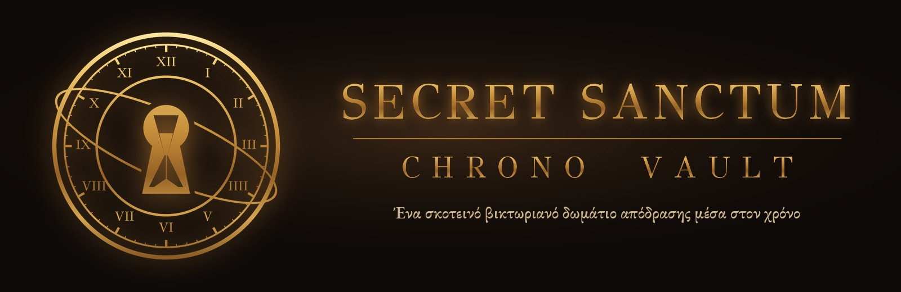
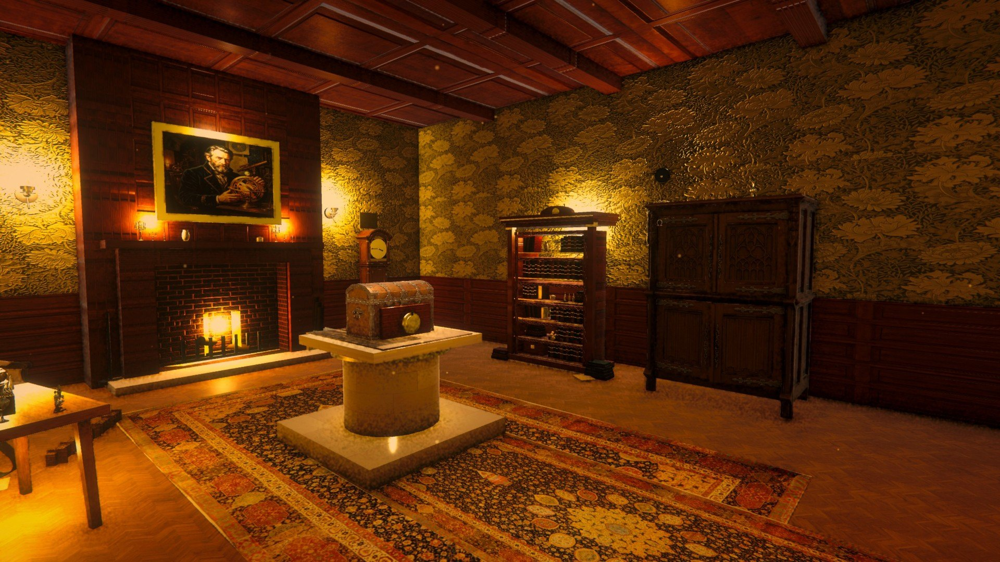
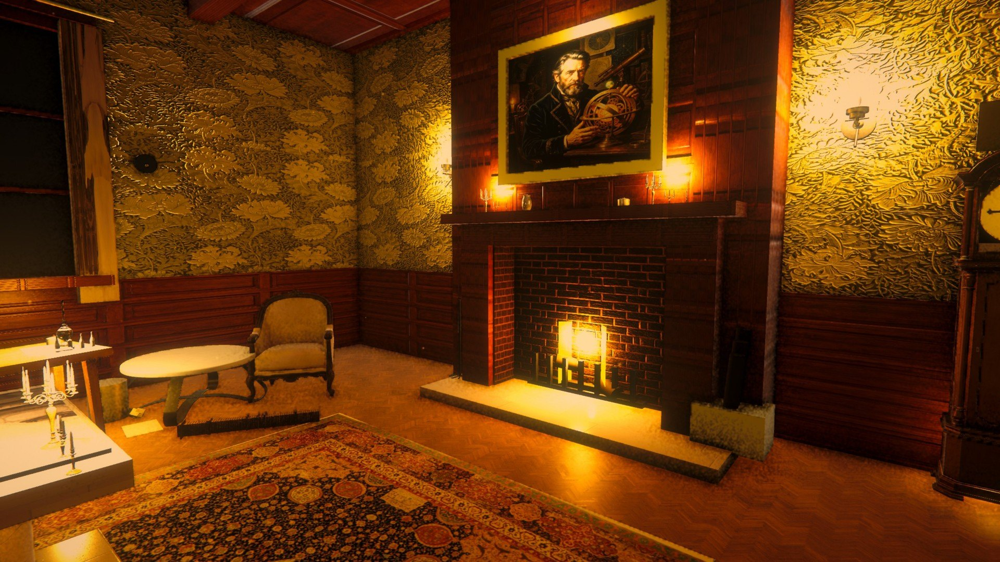
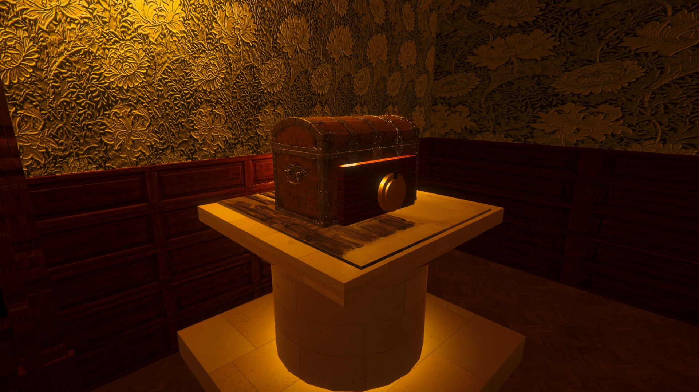
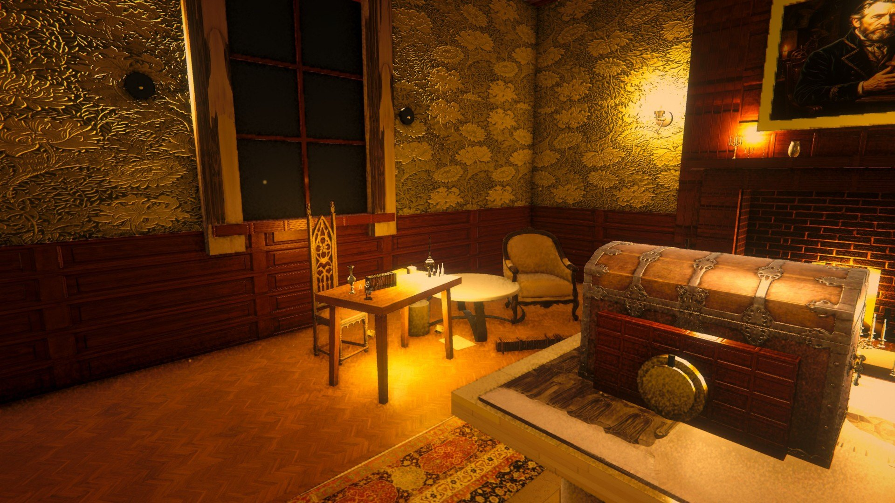
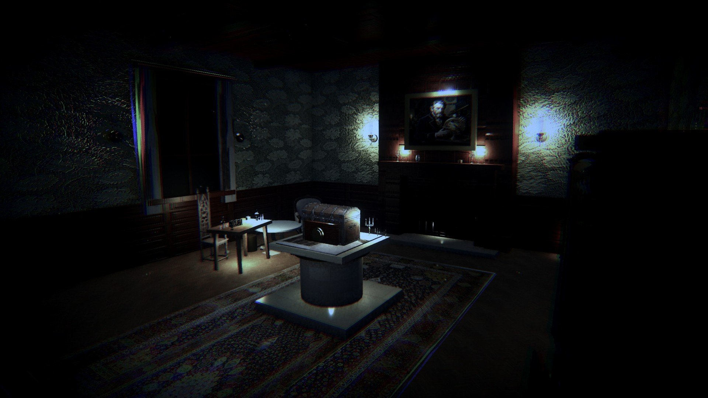
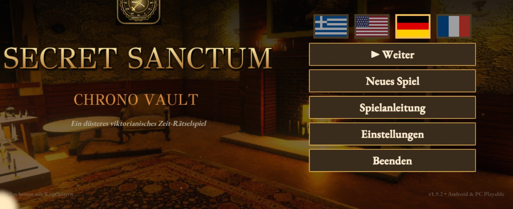
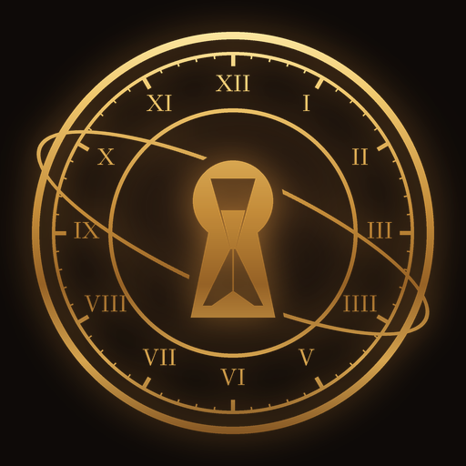

 

**[Ελληνικά](#-ελληνικά) · [English](#-english)**

---

## 🇬🇷 Ελληνικά

> *Οκτώβριος 1895. Το εργαστήριο του καθηγητή Vance είναι ζεστό ακόμα· η φωτιά καίει, το εκκρεμές χτυπά. Ο ίδιος έχει εξαφανιστεί. Η βαριά πόρτα είναι σφραγισμένη, και κάτι στο δωμάτιο δεν ανήκει σε αυτή την εποχή.*

Το **Secret Sanctum: Chrono Vault** είναι ένα σκοτεινό, ατμοσφαιρικό 3D δωμάτιο απόδρασης για Android. Εξερευνάς ένα βικτωριανό εργαστήριο, εξετάζεις κάθε αντικείμενο από κοντά, ενώνεις στοιχεία και λύνεις γρίφους που συνδέονται μεταξύ τους. Με τον **Χρονικό Φακό** βλέπεις το ίδιο δωμάτιο σε άλλη εποχή, και ό,τι κρύβει το παρελθόν μπορεί να φαίνεται μόνο εκεί.

Και δεν είναι μόνο το παρελθόν που κρύβεται σε αυτό το δωμάτιο.

> [!WARNING]
> Περιέχει σκοτεινή ατμόσφαιρα και ξαφνικούς τρόμους. Μπορείς να τους κλείσεις από τις **Ρυθμίσεις → Ξαφνικοί τρόμοι: Όχι**.

### 📸 Εικόνες

<table>
  <tr>
    <td width="50%"> <b>Το εργαστήριο.</b> Κάθε γωνιά κρύβει κάτι.</td>
    <td width="50%"> <b>Το τζάκι.</b> Φωτιά, σπίθες και ο ήχος της βροχής στο τζάμι.</td>
  </tr>
  <tr>
    <td> <b>Το Χρονο-Κιβώτιο.</b> Κλειδωμένο. Για την ώρα.</td>
    <td> <b>Το γραφείο του καθηγητή.</b> Χαρτιά, όργανα και ένα παράθυρο στη νύχτα.</td>
  </tr>
  <tr>
    <td> <b>Το ίδιο δωμάτιο, άλλη εποχή.</b> Ο Χρονικός Φακός αλλάζει τα πάντα.</td>
    <td> <b>Το μενού.</b> Ελληνικά ή αγγλικά, με μία επιλογή.</td>
  </tr>
</table>

### ✨ Τι θα βρεις

- 🕯️ **Ένα δωμάτιο που ζει.** Φωτιά που τρίζει, εκκρεμές, βροχή στο τζάμι, σκόνη στο φως. Ηχογραφημένος ήχος σε κάθε χώρο. Παίζεται καλύτερα με ακουστικά.
- 🔍 **Εξέταση από κοντά.** Πάτα ένα σημείο που λάμπει και η κάμερα πηγαίνει κοντά. Ανοίγεις συρτάρια, γυρίζεις δίσκους, διαβάζεις σημειώματα.
- ⏳ **Ο Χρονικός Φακός.** Το ίδιο δωμάτιο σε άλλη εποχή, με άλλα φώτα, άλλη ατμόσφαιρα και άλλα μυστικά.
- 🧩 **Γρίφοι που δένουν μεταξύ τους.** Ένα στοιχείο εδώ ανοίγει κάτι εκεί. Τίποτα δεν είναι διακοσμητικό χωρίς λόγο.
- 📖 **Η ιστορία του Vance**, κομμάτι κομμάτι, σε σημειώματα, πεταμένα πρόχειρα και σελίδες ημερολογίου.
- 🚪 **Τρία δωμάτια, ένα τέλος που διαλέγεις.** Το γραφείο, το υπόγειο και ό,τι κρύβεται πίσω από την τελευταία πόρτα. Η ιστορία κλείνει με δύο τρόπους.
- 🔎 **Αντικείμενα που χρησιμοποιείς.** Κρατάς τον φακό ή το κερί και τα δοκιμάζεις πάνω σε ό,τι βρεις.
- 📓 **Σημειωματάριο.** Ό,τι διαβάζεις γράφεται μόνο του, για να μη χρειάζεται χαρτί και μολύβι.
- 🎧 **Ήχος με κατεύθυνση.** Βήματα και θόρυβοι ακούγονται από το σημείο τους μέσα στο δωμάτιο.
- 🔠 **Μεγάλα, ευανάγνωστα γράμματα** στο κινητό, και ένα μάτι που κρύβει τα εργαλεία, για να βλέπεις καθαρά το δωμάτιο.
- 🎙️ **Αφήγηση** σε ελληνικά και αγγλικά, με κινηματογραφικές σκηνές.
- 💡 **Βοήθειες** όταν κολλήσεις, που σε σπρώχνουν χωρίς να σου χαλάνε τη λύση.
- 📳 **Δονήσεις** σε μοχλούς, διακόπτες και κλειδαριές.
- 📶 **Παίζεται χωρίς internet.** Χωρίς λογαριασμό, χωρίς εγγραφή.

### 📥 Εγκατάσταση

| | |
|---|---|
| **Λήψη** | **[📲 SecretSanctum-ChronoVault.apk](https://github.com/jemangr/SecretSanctum-ChronoVault-Releases/releases/latest/download/SecretSanctum-ChronoVault.apk)** (πάντα η τελευταία έκδοση) |
| **Συσκευές** | Android 8.0 ή νεότερο, σε οριζόντια θέση |
| **Μέγεθος** | περίπου 102 MB |

1. Πάτα το κουμπί λήψης από το κινητό σου.
2. Άνοιξε το αρχείο που κατέβηκε και πάτα **Εγκατάσταση**. Αν σου ζητηθεί, επίτρεψε την εγκατάσταση από αυτή την πηγή.
3. Χαμήλωσε τα φώτα, βάλε ακουστικά και ξεκίνα.

> [!TIP]
> Τα «Γραφικά» ξεκινούν στα «Ισορροπημένα», που τρέχουν ομαλά στα περισσότερα κινητά. Σε δυνατό κινητό δοκίμασε **Ρυθμίσεις → Γραφικά: Κινηματογραφικά**.

### 🔄 Ενημερώσεις

Από την έκδοση **1.9.1**, το παιχνίδι ελέγχει μόνο του για νέα έκδοση και την κατεβάζει από το ίδιο το μενού. Την εγκατάσταση την επιβεβαιώνεις εσύ, και η πρόοδός σου κρατιέται. Στις **Ρυθμίσεις → Ενημερώσεις & αναφορά προβλήματος** μπορείς να κλείσεις τον αυτόματο έλεγχο ή να ελέγξεις αμέσως.

Όλες οι εκδόσεις και οι αλλαγές τους: **[Releases](https://github.com/jemangr/SecretSanctum-ChronoVault-Releases/releases)**.

### 🐞 Βρήκες πρόβλημα;

Μέσα από το παιχνίδι: **Ρυθμίσεις → Ενημερώσεις & αναφορά προβλήματος → Αναφορά προβλήματος**. Γράφεις τι έγινε και το στέλνεις με email. Μπαίνουν μόνο η έκδοση, το μοντέλο του κινητού, η πρόοδος στο παιχνίδι και τα τεχνικά σφάλματα, ποτέ προσωπικά στοιχεία.

Μπορείς επίσης να γράψεις στο **info@3wsol.gr**.

### 🔒 Απόρρητο

Το παιχνίδι δεν ζητά λογαριασμό και δεν συλλέγει προσωπικά στοιχεία. Συνδέεται στο internet μόνο για να δει αν υπάρχει νέα έκδοση (στο GitHub). Μια αναφορά προβλήματος φεύγει μόνο αν την στείλεις εσύ, από τη δική σου εφαρμογή email.

---

## 🇬🇧 English

> *October 1895. Professor Vance's study is still warm; the fire burns, the pendulum ticks. The professor is gone. The heavy door is sealed, and something in the room does not belong to this time.*

**Secret Sanctum: Chrono Vault** is a dark, atmospheric 3D escape room for Android. Explore a Victorian study, examine every object up close, connect the clues and solve puzzles that build on one another. With the **Chrono Lens** you see the same room in another era, and what the past hides may only show there.

And the past is not the only thing hiding in this room.

> [!WARNING]
> Contains a dark atmosphere and sudden scares. You can turn them off in **Settings → Jump scares: Off**.

### ✨ Features

- 🕯️ **A room that feels alive:** a crackling fire, a ticking pendulum, rain on the window, dust in the light. Recorded sound in every space. Best with headphones.
- 🔍 **Close-up inspection:** tap a glowing spot and the camera moves in. Open drawers, turn dials, read notes.
- ⏳ **The Chrono Lens:** the same room in another era, with different light, mood and secrets.
- 🧩 **Puzzles that connect:** a clue here opens something there.
- 📖 **Vance's story**, piece by piece, in notes, discarded drafts and journal pages.
- 🔎 **Items you use:** hold the lens or the candle and try them on what you find.
- 📓 **A notebook:** whatever you read is written down by itself, so you need no pen and paper.
- 🎧 **Sound with direction:** footsteps and noises come from where they are in the room.
- 🚪 **Three rooms, an ending you choose.** The study, the cellar and what lies behind the last door. The story closes in two ways.
- 🔠 **Large, readable text** on phones, and an eye button that hides the tools so you can see the room clearly.
- 🎙️ **Narration** in Greek and English, with cinematic scenes.
- 💡 **Hints** that nudge you without spoiling the answer.
- 📳 **Haptics** on levers, switches and locks.
- 📶 **Plays offline.** No account, no sign-up.

### 📥 Install

**[📲 Download SecretSanctum-ChronoVault.apk](https://github.com/jemangr/SecretSanctum-ChronoVault-Releases/releases/latest/download/SecretSanctum-ChronoVault.apk)** (always the latest version). Android 8.0 or newer, landscape, about 102 MB.

1. Tap the download button on your phone.
2. Open the downloaded file and tap **Install**. If asked, allow installs from this source.
3. Dim the lights, put on headphones and begin.

Graphics start on **Balanced**, which runs smoothly on most phones. On a powerful phone, try **Settings → Graphics: Cinematic**.

### 🔄 Updates

Since **1.9.1** the game checks for new versions by itself and downloads them from the menu. You confirm the install, and your progress is kept. **Settings → Updates & problem reports** turns the automatic check off or checks right away.

### 🐞 Found a problem?

In the game: **Settings → Updates & problem reports → Report a problem**. Only the version, phone model, game progress and technical errors are added, never anything personal. Or write to **info@3wsol.gr**.

### 🔒 Privacy

No account and no personal data. The game goes online only to check for a new version (on GitHub). A problem report is sent only if you send it, from your own email app.

---

**Secret Sanctum: Chrono Vault** · © 2026 jemangr. All rights reserved. 
This repository holds the release files only. 3D models and textures from Poly Haven, Poly Pizza and ambientCG (CC0), sounds from OpenGameArt and Kenney (CC0), fonts GFS Didot and EB Garamond (SIL Open Font License).

